<!-- NILOJAN // SPIDER-MAN FAN-THEMED DEVELOPER PROFILE -->

### ✦ CONNECT WITH ME ✦

---

## 🕸️ ABOUT ME

- 👨‍💻 Developer and technology enthusiast
- 🤖 Exploring Artificial Intelligence and intelligent agents
- ⚡ Building projects with ESP32, IoT, and embedded systems
- 🌐 Interested in web development and automation
- 🚀 Learn, build, experiment, and improve every day

## 🕷️ TECH STACK

## 🕸️ FEATURED PROJECTS

| Project | Description | Tech |
|---|---|---|
| [EcoSort AI](https://github.com/nilojan2025/EcoSort-AI-Intelligent-Waste-Management-AI-Agent) | AI-powered waste management concept | AI |
| [ESP32 Web LED Controller](https://github.com/nilojan2025/ESP32-Web-LED-Controller) | Web control for ESP32 LEDs | ESP32 · Web |
| [ESP32 Bluetooth Serial](https://github.com/nilojan2025/ESP32-Bluetooth-Serial-Communication) | Bluetooth serial communication | ESP32 |
| [InternSeek](https://github.com/nilojan2025/InternSeek) | Internship opportunity discovery | Web |

## 🕷️ GITHUB STATS

 

🕸️ YOUR FRIENDLY NEIGHBORHOOD DEVELOPER • KEEP BUILDING • KEEP EXPLORING 🕷️

